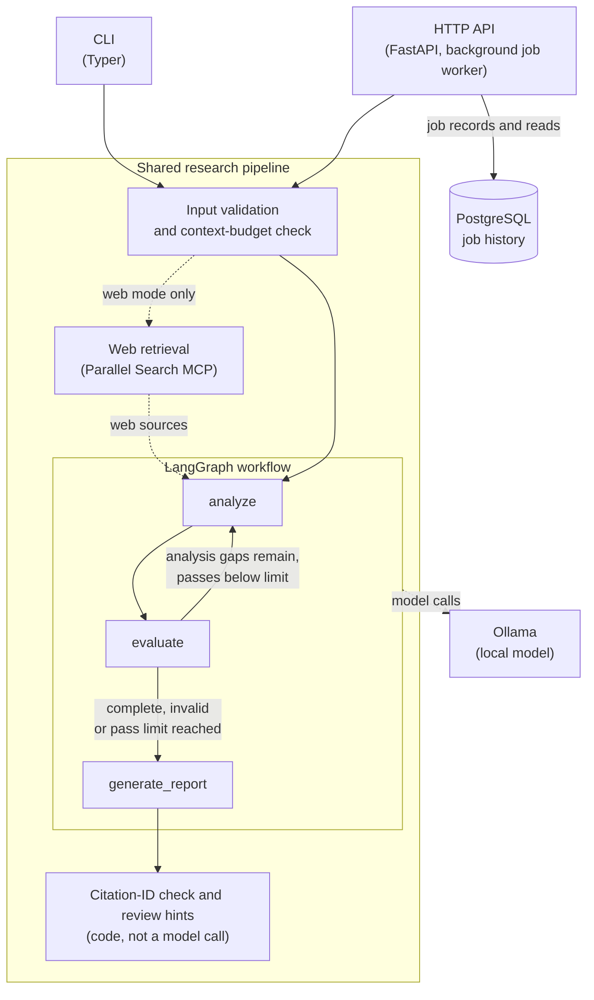

# ResearchPilot

**Local-first, source-grounded research synthesis with LangGraph and Ollama.**

ResearchPilot answers a research question from source material you supply. A local Ollama model analyzes the sources in a bounded LangGraph loop and writes a report that cites each source by ID. It runs as a command-line tool or as a local HTTP API with background jobs and PostgreSQL-backed history. No paid model API is needed; web retrieval is optional and off by default.

## Architecture



The CLI and the HTTP API run the same pipeline. Each LangGraph node calls the local Ollama model; evaluation sends the run back to analysis only while analysis gaps remain, and the pass limit always ends the loop. After the report is written, code checks that its citation IDs refer to supplied sources and adds heuristic review hints; it does not verify that a source supports a claim. Web retrieval runs only when requested. The API's job worker records each job's lifecycle and result in PostgreSQL, which the API reads back after a restart; the model and the graph never use the database.

## Key features

- **Source-grounded reports.** Supplied sources are numbered `[S1]`, `[S2]`, ... and the report cites them by ID.
- **Bounded analysis loop.** Analyze, evaluate coverage, re-analyze only while gaps remain, and always stop within a configurable pass limit.
- **Local inference without a paid model API by default.** Ollama (`gemma3:4b` by default); oversized input is rejected, never truncated.
- **Citation-ID checks and review hints.** Unknown or internal references are flagged in code; heuristics point out wording a human should review.
- **Optional web retrieval.** One bounded search through Parallel Search MCP, with URL safety checks and untrusted-content handling.
- **Evidence capture.** `--save-sources` saves exactly what a run used, for debugging.
- **HTTP API with persistent history.** Submit, poll, fetch results and cancel; jobs are stored in PostgreSQL (Alembic migrations), protected by a single-instance lock, and never re-run after a restart.
- **Offline test suite.** Fake models, web clients and history; PostgreSQL and live tests are opt-in.

## Technology stack

| Area | Technology |
|---|---|
| Language and tooling | Python 3.12+, `uv`, Ruff, pytest |
| Orchestration and inference | LangGraph, LangChain Core, Ollama via `langchain-ollama` |
| Validation and settings | Pydantic, pydantic-settings |
| CLI | Typer, Rich |
| HTTP API | FastAPI, Uvicorn |
| Persistence | PostgreSQL, SQLAlchemy 2, Psycopg 3, Alembic |
| Web retrieval | Official `mcp` SDK, Parallel Search MCP server |
| Manual API testing | Postman collection (importable into Bruno) |

## Contents

- [Setup (Windows PowerShell)](#setup-windows-powershell)
- [Using the CLI](#using-the-cli)
- [Web mode](#web-mode)
- [HTTP API](#http-api)
- [Testing](#testing)
- [Project structure](#project-structure)
- [Known limitations](#known-limitations)

## Setup (Windows PowerShell)

Requirements: Python 3.12+, `uv`, and [Ollama](https://ollama.com/download) running locally. The HTTP API also needs a PostgreSQL database with UTF-8 encoding. No API key or paid service is required.

```powershell
ollama pull gemma3:4b    # default model, about 3 GB
ollama list              # check that the Ollama server is reachable (start it with `ollama serve`)
uv sync                  # install dependencies
```

Configuration is optional. To override the defaults, copy the example file and edit it (the same names also work as environment variables):

```powershell
Copy-Item .env.example .env
```

| Setting | Default | Meaning |
|---|---|---|
| `OLLAMA_MODEL` | `gemma3:4b` | Ollama model name (`ollama pull` it first) |
| `OLLAMA_BASE_URL` | `http://localhost:11434` | Ollama server address |
| `OLLAMA_TEMPERATURE` | `0` | Sampling temperature, 0–2 |
| `OLLAMA_NUM_CTX` | `16384` | Context window requested from Ollama, in tokens (2048–131072) |
| `OLLAMA_NUM_PREDICT` | `2048` | Maximum tokens per model response (256–8192, at most a quarter of `OLLAMA_NUM_CTX`) |
| `RESEARCHPILOT_MAX_ANALYSIS_PASSES` | `2` | Maximum analysis passes, 1–3 |

Smaller models are faster but follow the source-grounding and JSON instructions less reliably. The HTTP API has its own settings, listed under [HTTP API](#http-api).

**Input size.** Sources are never truncated. Before calling the model, ResearchPilot estimates the largest prompt (about 3 characters per token) and rejects input that would not fit, with exit code 2. With the defaults, a source file of roughly 27,000 characters fits; with `OLLAMA_NUM_CTX=32768`, roughly 76,000. On machines with little RAM or VRAM, lower it (for example `OLLAMA_NUM_CTX=8192` with `OLLAMA_NUM_PREDICT=1024`, about 11,500 characters).

## Using the CLI

Create `sources.md`, starting each source with a top-level heading and keeping its title and URL with the excerpt:

```markdown
# Source A: Task completion

https://example.com/report (excerpt) ...

# Source B: Evaluation limitations

...
```

Each top-level `#` heading starts a new source, numbered `[S1]`, `[S2]`, ... in order. `##` subheadings and headings inside code blocks stay within their source; text before the first heading becomes its own source, and a file with no headings is a single source. Label-like text inside a source, such as `[S2]`, is rewritten as `(S2)` so one source cannot impersonate another.

```powershell
uv run researchpilot "Compare the approaches described in these sources" --source-file .\sources.md
uv run researchpilot "Summarize the evidence and limitations" --source-file .\sources.md --output .\reports\research-report.md
```

| Option | Meaning |
|---|---|
| `--source-file`, `-s` | Markdown or text file with the source material (required) |
| `--output`, `-o` | Also save the Markdown report to this path |
| `--verbose`, `-v` | Log each model call (node, pass, seconds, prompt size, token counts) to stderr |
| `--web`, `-w` | Add one bounded web retrieval before analysis (see [Web mode](#web-mode)) |
| `--save-sources` | Write the evidence the run used to a new JSON file (see below) |

Exit code 2 means the input or options were rejected before any model call; exit code 1 means the run, web retrieval or a requested file write failed. After each run, stderr shows a one-line summary: analysis passes, model calls, total time, time per graph node, and why the loop stopped. Logs contain counts and timings, never source text.

### How a run works

```text
START → analyze → evaluate ──(analysis gaps remain, passes < max)──→ analyze
                     │
                     └──(complete, invalid evaluation, or pass limit)──→ generate_report → END
```

1. **analyze** writes notes from the supplied sources. A repeat pass gets the previous notes and the evaluator's analysis gaps.
2. **evaluate** returns *analysis gaps* (in the sources but missing from the notes; another pass can fix them), *source gaps* (not in the sources at all) and *conflicts* between sources. Ollama's structured-output mode constrains the reply to a JSON schema from the Pydantic model, which then validates it. The analysis counts as complete when the analysis-gap list is empty; only analysis gaps trigger another pass.
3. **generate_report** writes the report, listing source gaps and conflicts under "Gaps, Conflicts, and Limitations".

A run makes at most `2 × RESEARCHPILOT_MAX_ANALYSIS_PASSES + 1` model calls (5 by default, 7 at most). An evaluation that cannot be validated is recorded as invalid, never as complete. If the run stops with an invalid evaluation or at the pass limit with gaps open, the report starts with an **Incomplete analysis** notice and ends with a note explaining why; at the pass limit the unresolved analysis gaps are also returned in `ResearchReport.unresolved_analysis_gaps` and counted in the stderr summary. The default limit is 2 passes because each local model call takes minutes on CPU.

### Citation check

After the report is generated, ResearchPilot checks it in code and flags:

- IDs that are not supplied sources, such as `[S7]` when there are three sources;
- internal prompt-block labels written like a citation or tag, such as `[run_status]`, `<analysis_notes>` or `{source_material}` (bare names in prose or `code` are not flagged);
- references to internal steps ("analysis notes", "run status") instead of sources;
- a report with no valid source ID at all.

Problems are listed in a note appended to the report, with the ID-to-title key, and in `ResearchReport.invalid_citations`; the report text is never rewritten. **A valid ID only shows which source a sentence points to; it does not prove that the source supports the claim.** Check references against the supplied material.

### Review hints (heuristic)

Two word-pattern checks may add **review hints** for a human reviewer, in a separate note and in `ResearchReport.quality_warnings`. They never change the report, the citation results or the exit code.

- **Possible over-generalization:** a cited sentence uses a generalizing word (often, frequently, commonly, generally, typically, usually, widely) that none of its cited sources uses. It is a review signal, not an evidence-support check.
- **Possible contradiction:** a claim that the sources *as a whole* lack something ("the sources do not address X", "no source…", "none of the sources…") shares at least three content words with a cited statement. Statements that one source reports something missing are not compared. It misses contradictions between two positive statements, absence claims worded differently, and synonyms.

Hints can be wrong in either direction, and a report without hints is not thereby supported. The prompts also ask the model to keep claims at their source's scope, to use technical terms only as the sources define them and never to write internal block names; a small local model may not follow these instructions.

### Saving the evidence (`--save-sources`)

To debug a report, save the exact evidence a run used to a new JSON file:

```powershell
uv run researchpilot "Summarize the evidence and limitations" --source-file .\sources.md --output .\reports\report.md --save-sources .\reports\report-evidence.json
```

The file holds every source as numbered for the run, each pass's analysis notes and structured evaluation, the stop reason, unresolved gaps, web retrieval counts, the non-secret model settings and report metadata. It never holds full prompts, raw evaluator replies, environment variables or the Ollama base URL. It does hold full source text and analysis notes, which may be private: it is written only when you ask for it, and its contents are never printed or logged.

<details>
<summary>File format and destination rules</summary>

The file (`schema_version` 2) holds every source, in ID order, with:

- `id`, `type` (`local` or `web`) and `text`: the exact text as numbered for the run;
- `numbered_title`: the title as it appears in the numbered text, the prompts and the citation notes (label-like text such as `[S2]` rewritten as `(S2)`; for web sources, `<evidence type>: <page title> — <url>`);
- for web sources also `evidence_type`, `url` and `page_title`: the page title after retrieval cleanup but before label rewriting, so it may differ from what the model saw.

`source_block_format` gives the rebuild rule, `"\n\n".join(f"[{id}]\n{text}")`, and `source_block_sha256` is the SHA-256 of that block after delimiter escaping, which is what every analysis, evaluation and report prompt contained. `text_handling` documents each transformation the stored texts went through: delimiter escaping (applied only in prompts, not to the stored texts), label rewriting, web-text cleanup and clipping, note trimming, and evaluator-list validation.

Report metadata includes the `--output` path, citation problems, review hints, timings and two hashes:

- `markdown_sha256`: the report Markdown string itself (UTF-8, LF line endings, no added newline);
- `output_file_sha256`: the exact bytes of the `--output` file, read back after writing (on Windows that file has CRLF line endings and a final newline, so the two hashes differ); `null` without `--output`.

The report text itself stays in its own file. Version 1 files, written before this change, used `title` (the page title for web sources), had a text-only `text_handling`, and had no `source_block_format` or `output_file_sha256`.

The destination is checked before any model or network call (exit code 2 on failure). It must end in `.json`; must not exist yet (it is never overwritten); its folder must already exist (folders are not created); and it must differ from the source file and the `--output` path, including through `\\?\` long-path aliases, 8.3 short names, case or `..` segments. On Windows it must also not be a device path (`\\.\...`), an alternate data stream (`notes.md:x.json`, which would write into another file) or a reserved device name (`NUL.json`, `CON.json`, `COM1.json`, ...). The file is written to a temporary file in the same folder and then published without overwriting, so a failure never leaves a partial file. If writing fails after the report is done, the report is still printed and saved, and the CLI exits with code 1. A run that fails part-way writes no evidence file.

</details>

## Web mode

```powershell
uv run researchpilot "How do LangGraph conditional edges route between nodes?" --source-file .\sources.md --web
```

`--web` (`-w`) adds web evidence to the supplied source file, which is still required. Without it, no MCP connection or network request is made. Before analysis, `researchpilot.web_research` runs:

1. **One search.** The question is the search objective and its first 12 words are the keyword query. Up to 5 results are kept.
2. **Up to 2 fetches** of the unique, safe results with the most substantive excerpts. A fetched page with fewer than 300 meaningful characters is skipped as low quality; its search excerpt is kept, and no replacement fetch is made.

Search excerpts and fetched pages become separate sources, numbered after the local ones, so the citation check covers them too; each web source's title holds its evidence type, page title and URL, and the report ends with a note listing each web ID with its URL. Excerpts are clipped to 1,200 characters, pages to 3,000 and all web text to 12,000. Retrieval has a 120-second deadline on top of a 60-second per-call timeout, never retries, and counts toward the context budget. Retrieved text is treated as untrusted evidence: label-like text and prompt delimiters are neutralized, and the prompts tell the model to ignore instructions in pages, but a small local model may still be influenced.

<details>
<summary>Retrieval and safety details</summary>

- **Fetch selection.** Fetches run one per call; excerpt size for ranking is capped at the 1,200-character clip length, and ties keep the search rank. Low-quality detection collapses whitespace and drops link-only, symbol-only and common login, cookie and navigation lines.
- **URL checks.** Only `http`/`https` URLs are used. Rejected: credentials in the URL, `localhost` and `.local`/`.internal`-style hosts, single-label and numeric hosts, and IP addresses that are not globally routable (loopback, private, link-local such as `169.254.169.254`, shared, reserved, multicast, IPv4-mapped forms). URLs are normalized (lowercase scheme and host, ASCII host, no fragment, default port or `utm_*` tracking parameters, matched in any case; other query parameters keep their order and encoding) and deduplicated. Fetched content is accepted only when the URL the fetch reports normalizes to the URL that was requested, so redirects to other URLs are rejected. Parallel's servers do the fetching; this machine never connects to result URLs.
- **Untrusted content.** Retrieved text is evidence only and is never split into further sources. Label-like text such as `[S1]` is rewritten, prompt delimiter tags are escaped, and leading `#` marks are escaped. Instructions in pages are not followed by the software.
- **Failures.** If connecting or searching fails, times out, returns malformed data or has no usable result, the run stops with exit code 1 before any model call. A failed, malformed, empty, low-quality or redirected fetch is skipped with a warning on stderr, and the search excerpts are still used. Nothing is invented for a failed call.
- **Reporting.** If the report stops at the pass limit or with an invalid evaluation, its closing note names the web sources instead of saying that only the supplied material was consulted. stderr shows any warnings and a one-line count (searches, fetches, sources added); retrieved text and settings are not logged.

</details>

<details>
<summary>Parallel Search MCP client</summary>

`researchpilot.parallel_mcp` is a standalone async client for the public [Parallel Search MCP server](https://search.parallel.ai/mcp), using the official `mcp` SDK over Streamable HTTP. No API key is needed; ResearchPilot uses it only in web mode.

On connection it lists the server's tools (currently `web_search` and `web_fetch`) and keeps their names, descriptions and input schemas. Calls send only arguments that the discovered schema declares, and fail with `ParallelMCPError` if a required argument is unsupported, a tool is missing, or the server reports an error, times out or returns a malformed or empty result. Error messages do not include server error text.

```python
import asyncio

from researchpilot.parallel_mcp import ParallelSearchMCPClient


async def main() -> None:
    async with ParallelSearchMCPClient(timeout_seconds=60) as client:
        for tool in await client.list_tools():
            print(tool.name, sorted(tool.input_schema["properties"]))
        found = await client.search(
            "Official LangGraph docs on conditional edges", ["LangGraph conditional edges"]
        )
        page = await client.fetch(
            "https://docs.langchain.com/oss/python/langgraph/graph-api",
            objective="How conditional edges route between nodes",
        )
        print(found.content[0].text[:500], page.content[0].text[:500], sep="\n\n")


asyncio.run(main())
```

Use of the server is subject to Parallel's [terms](https://parallel.ai/customer-terms) and [privacy policy](https://parallel.ai/privacy-policy).

</details>

## HTTP API

The API runs the same research as the CLI as background jobs, one at a time, and records every job in PostgreSQL so it can still be read after a restart. **It binds to `127.0.0.1:8000` (localhost) by default and has no authentication and no CORS configuration: keep it local and do not expose it to a network.**

### Configure, migrate and start

You need Ollama running with the configured model and a UTF-8 PostgreSQL database, for example in Docker:

```powershell
docker run -d --name researchpilot-db -p 5432:5432 -e POSTGRES_USER=researchpilot -e POSTGRES_PASSWORD=<password> -e POSTGRES_DB=researchpilot postgres:17
```

The API reads `RESEARCHPILOT_DATABASE_URL` from the environment or `.env`; it must use the `postgresql+psycopg://` scheme. Do not commit it.

```powershell
$env:RESEARCHPILOT_DATABASE_URL = "postgresql+psycopg://researchpilot:<password>@127.0.0.1:5432/researchpilot"
uv run alembic upgrade head        # explicit; the API never migrates the database itself
uv run python -m researchpilot.api
```

| Setting | Default | Meaning |
|---|---|---|
| `RESEARCHPILOT_DATABASE_URL` | none | Job history database; without it the API starts but refuses jobs (503 `history_unconfigured`) |
| `RESEARCHPILOT_API_HOST`, `RESEARCHPILOT_API_PORT` | `127.0.0.1`, `8000` | Listening address |
| `RESEARCHPILOT_API_MAX_QUEUED_JOBS` | `4` | Jobs waiting behind the running one |
| `RESEARCHPILOT_API_MAX_RETAINED_JOBS` | `50` | Finished jobs kept in memory (older ones are read from the database) |
| `RESEARCHPILOT_API_MAX_REQUEST_BYTES` | `1048576` | Largest accepted request body |

Interactive documentation is at `http://127.0.0.1:8000/docs` (Swagger UI), `/redoc`, and the schema at `/openapi.json`.

### Endpoints

Errors are `application/problem+json` bodies with a stable `code`; they never contain source text, exception messages or connection details.

| Request | Success | Common errors |
|---|---|---|
| `GET /api/v1/health` | 200 `{"status": "ok", ...}` | none: liveness only |
| `GET /api/v1/health/ready` | 200, checks `ollama`, `jobs`, `history` all `ok` | 503 `jobs_unavailable`, `history_unavailable`, `history_schema_outdated`, `history_unconfigured`, `ollama_unavailable` |
| `POST /api/v1/jobs` | 202, job status (`queued`) and a `Location` header | 422 `validation_failed` or `input_too_large`, 413 `content_too_large`, 503 `queue_full` (with `Retry-After`), `jobs_unavailable`, `history_*` |
| `GET /api/v1/jobs/{job_id}` | 200, job status | 404 `job_not_found`, 503 `history_*` |
| `GET /api/v1/jobs/{job_id}/result` | 200, the research result | 409 `job_not_finished`, `job_failed`, `job_cancelled`; 404; 503 |
| `POST /api/v1/jobs/{job_id}/cancel` | 200, job status (`cancelled`) | 409 `job_not_cancellable` (running or finished), 404, 503 |

A submission is `{"question": ..., "source_material": ..., "web": false, "label": ...}`: the same limits as the CLI apply, `web` adds one Parallel Search MCP retrieval, and the optional `label` (trimmed, at most 120 characters) is stored with the job but not returned.

- **Liveness** (`/health`): the process is running.
- **Readiness** (`/health/ready`): jobs can be accepted and run now. History must be ready (database reachable, schema current, and this instance holding the single-instance lock) and Ollama must answer.
- **Job status** (`/jobs/{job_id}`): one job's lifecycle: `queued`, `running`, then `succeeded`, `failed` or `cancelled`. A job left unfinished by a previous process is reported as `failed` with code `interrupted_by_restart`; it is never re-run.

### Job history and durability

- A job is recorded as queued before it can run, and as running before research starts; if either write fails, the job is refused or failed without running research.
- A finished job whose outcome could not be saved is never presented as finished: its status and result return 503 `history_unavailable`.
- Reads use the in-memory job when there is one, and otherwise the database, so jobs stay readable after a restart until their retention ends (30 days for succeeded jobs, 14 days for failed or cancelled ones).
- Only one API instance at a time can own the history database (a PostgreSQL advisory lock). Stored reports and analysis notes may contain source-derived text; the submitted source material itself is never stored.

### Manual test with Postman

Import `postman/ResearchPilot.postman_collection.json` and `postman/ResearchPilot.local.postman_environment.json` (File > Import; Bruno can import the same collection), then select the **ResearchPilot local** environment. Submitting a job runs the local model and can take several minutes on CPU; the web-mode request also contacts the public Parallel Search MCP server. Send requests by hand:

1. **Liveness**, then **Readiness**: expect 200 for both.
2. **Submit research job**: 202; the job's id is saved as `jobId`.
3. **Job status**, repeatedly: `queued` and `running` are normal, not errors.
4. **Job result** once the status is `succeeded` (409 `job_not_finished` means poll again).
5. While a job is running, **Submit job to cancel**, then **Cancel job**: 200 `cancelled`, or 409 `job_not_cancellable` if it had already started.
6. Restart the API and send **Job status** and **Job result** for the first job: they are now read from the database.

**Invalid submission** shows a 422 without running any research.

<details>
<summary>Troubleshooting</summary>

| Symptom | Likely cause and fix |
|---|---|
| 503 `history_unconfigured` | `RESEARCHPILOT_DATABASE_URL` is not set, or does not use `postgresql+psycopg://`. Set it and restart. |
| 503 `history_unavailable` | PostgreSQL is unreachable, or another API instance holds the lock. Start the database or stop the other instance; readiness retries every few seconds. |
| 503 `history_schema_outdated` | Migrations are missing, or the database is not UTF-8. Run `uv run alembic upgrade head`. |
| 503 `ollama_unavailable` | Start Ollama (`ollama serve`) and check `OLLAMA_BASE_URL`. |
| 503 `jobs_unavailable` | The worker stopped (a fatal failure or a lost database lock). Restart the API. |
| A job stays `running` | Local models are slow: allow several minutes. A job is never interrupted; if the API stops meanwhile, the job becomes `failed` with `interrupted_by_restart` at the next start. |
| 503 `history_unavailable` for one job | Its outcome could not be saved, so it is not shown as finished. After a restart it reads as `interrupted_by_restart`. |

</details>

## Testing

The offline suite uses scripted fake models, fake web clients and fake history; it does not contact Ollama, a database or the network:

```powershell
uv run pytest -v
uv run ruff check .
uv run ruff format --check .
```

`tests/api/test_postman_collection.py` also checks the Postman collection and the [HTTP API](#http-api) endpoint table against the app's generated OpenAPI schema.

**PostgreSQL integration tests** are skipped unless you point them at a **dedicated, disposable** database whose name contains `test`. They create and drop their own schema and never touch the application's database:

```powershell
$env:RESEARCHPILOT_TEST_DATABASE_URL = "postgresql+psycopg://researchpilot:<password>@127.0.0.1:5432/researchpilot_test"
uv run pytest tests/history/test_history_postgres.py tests/api/test_job_history_postgres.py -v
Remove-Item Env:RESEARCHPILOT_TEST_DATABASE_URL
```

**Live tests** are opt-in. `tests/live/` runs the real model against known failure cases (claiming the task count is unknown, wrong source attribution, calling a limitation a conflict) and takes several minutes on CPU; model output is not deterministic, so a live pass is evidence, not proof. A separate smoke test calls the real Parallel Search MCP server (one listing, one search, one fetch); the unit tests in `tests/test_parallel_mcp.py` use an in-memory fake instead.

```powershell
$env:RESEARCHPILOT_LIVE_TESTS = "1"; uv run pytest tests/live -v; Remove-Item Env:RESEARCHPILOT_LIVE_TESTS
$env:RESEARCHPILOT_LIVE_MCP_TESTS = "1"; uv run pytest tests/live/test_live_parallel_mcp.py -v; Remove-Item Env:RESEARCHPILOT_LIVE_MCP_TESTS
```

### Deterministic evaluation

`tests/eval/test_golden_cases.py` runs a small golden set through the real pipeline with scripted model replies and a fake web gatherer, and compares run metrics from `researchpilot.evaluation` with explicit expectations: stop reason, analysis passes and pass-limit compliance, model calls, citation problems, source coverage, evaluator-reply validity, web-source numbering, neutralized label text in web pages, and failure categories. The metrics describe process and structure only; they do not judge whether a report is correct or whether a source supports a claim. Add a case by appending to `CASES`. Live-model evaluation is not part of CI.

### Continuous integration

GitHub Actions runs on pull requests to `main`, pushes to `main` and on demand. It uses only `uv.lock` (`uv sync --locked`), fake models and a disposable database; no Ollama, web search, paid API or secret is involved.

| Workflow | Job | What it checks |
|---|---|---|
| CI | Lint and format (Ruff) | `ruff check .` and `ruff format --check .` |
| CI | Offline tests (Linux, Python 3.12 / Linux, Python 3.13 / Windows, Python 3.13) | `pytest -m "not postgres and not live and not live_mcp"`, with JUnit and informational coverage |
| CI | PostgreSQL integration tests | Alembic upgrade, downgrade and upgrade through `alembic.ini`, then every `postgres` test against a `postgres:17` service container; fails if any is skipped |
| CI | Package build | `uv build`; the wheel must contain every migration file; the wheel is installed with locked dependencies in a throwaway environment and imported |
| Security | Dependency audit (pip-audit, advisory) | Known vulnerabilities in the locked packages, split into fixable and not yet fixed |
| Security | Workflow security lint (zizmor, advisory) | Permissions, pinning, credential persistence and injection risks in the workflows |

The Security workflow also runs weekly and never fails the build: findings appear as warnings and in the run summary. A fixable finding is actionable (update the package); one without a fix needs tracking. Dependabot proposes weekly, grouped updates for Python packages and actions. Test reports, coverage, audit results and the built package are attached to each run as artifacts for 14 days (the run's **Summary** page, **Artifacts**).

To run the same checks locally:

```powershell
uv sync --locked
uv run --locked ruff check .
uv run --locked ruff format --check .
uv run --locked pytest -m "not postgres and not live and not live_mcp"
uv build
```

Repository protection and settings that must be configured by hand are listed in [docs/maintainers.md](docs/maintainers.md).

## Project structure

```text
src/researchpilot/
├── cli.py            # Typer command-line interface
├── pipeline.py       # one research run, shared by the CLI and the API
├── graph.py          # LangGraph nodes, routing and compilation
├── service.py        # ResearchService: runs the graph
├── models.py         # Ollama chat model construction
├── prompts.py        # grounding rules and per-node prompts
├── state.py          # typed graph state and evaluator schema
├── schemas.py        # request and report models
├── results.py        # structured result returned by the API
├── sources.py        # source numbering and citation-reference checks
├── report_checks.py  # heuristic review hints (never change the report)
├── budget.py         # context-size estimates and limits
├── capture.py        # opt-in --save-sources evidence file
├── web_research.py   # web retrieval: URL checks, limits, web sources
├── parallel_mcp.py   # Parallel Search MCP client
├── errors.py         # typed errors for a research run
├── evaluation.py     # deterministic run metrics for regression evaluation
├── config.py         # validated settings
├── api/              # FastAPI app, job manager, routes, problem responses, history integration
└── history/          # PostgreSQL job history: models, store, advisory lock, Alembic migrations
postman/              # Postman collection and local environment for manual API tests
alembic.ini           # migration configuration (the URL comes from the environment)
tests/
├── conftest.py       # shared pytest setup
├── fakes.py          # scripted model, fake Parallel client and fake history
├── test_*.py         # offline tests for the research engine and CLI
├── api/              # offline API tests, plus opt-in PostgreSQL API tests
├── eval/             # deterministic golden cases for run metrics
├── history/          # offline history tests, plus opt-in PostgreSQL tests
├── manual/           # sample source files for manual CLI runs
└── live/             # opt-in live tests (Ollama, Parallel Search MCP)
```

## Known limitations

- **Citation checks validate source IDs, not support.** The checker confirms that a cited ID exists and flags internal references; it does not verify that the cited source supports the claim. Review hints catch only a few word patterns of over-generalization and contradiction; semantic errors (such as misdescribing a technical term) are not detected in code.
- **The evaluator is not an independent judge.** Coverage is assessed by the same local model that wrote the analysis. The JSON schema guarantees the shape of its answer, not its accuracy: `gemma3:4b` often reports gaps that are not real or that belong under source gaps, so runs frequently stop at the pass limit with a note listing those gaps, and its gap lists can vary between runs on identical input.
- **Prompt-injection protection is not guaranteed.** Web content is untrusted; the defenses reduce prompt injection but cannot rule it out with a small local model. A page that redirects is dropped even when the redirect is harmless.
- **Retrieval is basic.** Sources are supplied by hand unless web mode is used, and web retrieval is one keyword query taken from the question, with no query planning or follow-up searches.
- **Output is Markdown,** not yet a strict structured report schema.
- **Token counts are estimated** from character length, not measured with the model's tokenizer, and may be off for non-English text or code.
- **Runs are slow on CPU.** A run makes 3–5 model calls by default.
- **The HTTP API is not production-ready.** It is single-instance and intended for local use only: no authentication, no CORS configuration, no job listing, and no UI. There is no deployment target or container image.
- **Observability is logs only.** Job lifecycle events are logged with timings, stop reasons and failure codes (never source text); there are no metrics, tracing or dashboards.
- **Evaluation is structural.** The golden cases check process and citation-ID metrics with scripted replies; they say nothing about the quality of real model output.
